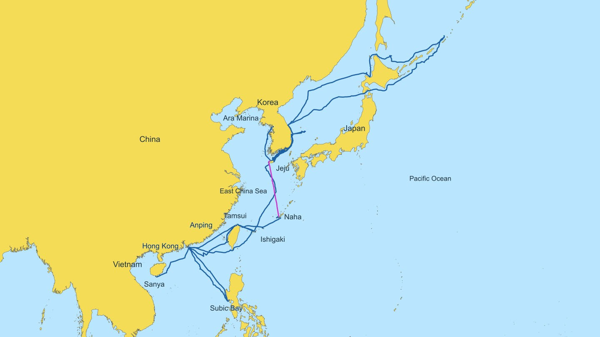
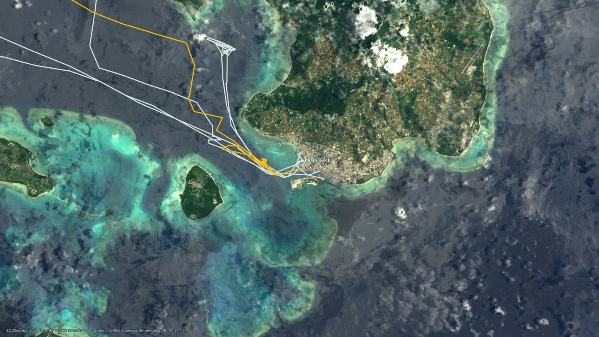

# Sailing Team Random Voyage

**GPX 항해 기록을 영상 편집용 4K 지도로 만드는 도구, Random Voyage · Map Studio.**

요트 항해의 전체 경로를 보여주면서 선택한 구간만 다른 색으로 강조합니다. 영상 사이에 넣는 5초 지도 컷과 투명 오버레이를 위해 만들었습니다. 서버 설치 없이 HTML 파일을 브라우저에서 열어 사용합니다.



[사용 방법](outputs/사용방법.txt) · [개발 가이드](CONTRIBUTING.md) · [개발 이슈](https://github.com/strongestweapon/SailingTeamRandomVoyage/issues) · [변경 이력](CHANGELOG.md) · [MIT License](LICENSE)

## 바로 사용하기

1. 저장소의 **Code → Download ZIP**으로 내려받고 압축을 풉니다.
2. `outputs/Random-Voyage-Map-Studio.html`을 Chrome 또는 Safari에서 엽니다.
3. 왼쪽 목록에서 강조할 구간을 선택합니다. 여러 개를 선택할 수 있고 다시 누르면 해제됩니다.
4. 지도 배경, 경로 색상, 지명, 구도를 조절합니다.
5. **4K PNG 저장**을 눌러 3840 × 2160 이미지를 저장합니다.

이용만 할 때는 Node.js나 Python 설치가 필요하지 않습니다. 새 GPX는 파일 추가 기능으로 불러옵니다. 추가 GPX와 바꾼 설정은 현재 브라우저 세션에만 유지됩니다.

## 주요 기능

- **전체 항적 + 선택 구간 강조:** 기록의 트리 구조, 구간별 토글, 모두 선택·해제.
- **지도 확대·이동:** 드래그, 휠, 핀치, 더블 클릭, 키보드. 기본 구도의 100–25,600%.
- **지명 설정:** 폰트·크기·색상, 출발·도착 이름, 선택적 강조. 지도 확대 중에도 글씨 크기는 고정됩니다.
- **겹침 완화:** 기항지 이름을 경로선과 다른 지명을 피해 배치하고 필요하면 연결선을 표시합니다.
- **영상 오버레이:** 바다 투명, 육지 불투명도 0–100%, 투명 PNG 저장.
- **좌표 복사:** 목적지 좌표를 `33.510175° N, 126.465374° E` 형식으로 복사합니다. 여러 구간은 표에 붙여넣을 수 있는 목록으로 복사하며 이미지에는 좌표 숫자를 넣지 않습니다.
- **4K 출력:** 저장 시점의 구도와 선택 상태를 고정합니다. 고해상도 위성은 필요한 타일을 모두 받은 뒤 출력합니다.

## 지도 배경

| 메뉴 | 자료 | 연결 | 특징 |
| --- | --- | --- | --- |
| Navionics · 색상 지도 | Natural Earth 해안선 | 오프라인 | 참고 이미지의 노랑 육지·하늘색 바다. 색상 직접 조절 |
| 위성 · Satellite | NASA Blue Marble, June 2004 | 오프라인 | 위성 합성 + 지형·해저 음영, 전체 항해 구도용 |
| 지형 · Relief | Natural Earth II | 오프라인 | 지표 색상 + 지형·해저 음영 |
| 고해상도 위성 · 온라인 | EOX Sentinel-2 cloudless 2016 | 인터넷 필요 | 확대 영역별 타일 로딩, 최대 z14, 4K 출력 |

Navionics 프리셋은 색상을 참고한 자체 지도입니다. Navionics 해도·수심 데이터나 공식 서비스와 연결된 제품이 아닙니다. 이 도구의 목적은 영상 제작입니다.



위성 배경: EOxCloudless / EOX IT Services GmbH, modified Copernicus Sentinel data 2016, [CC BY 4.0](https://creativecommons.org/licenses/by/4.0/). [4K 원본](outputs/Ishigaki_Satellite_HD_4K.png) · [자료 출처](NOTICE.md)

## 영상에 넣기

일반 지도 컷은 PNG를 편집 타임라인에 넣고 약 5초로 맞춥니다. 오버레이는 **바다 투명**을 켜서 저장한 PNG를 영상 위 트랙에 놓습니다. 미리보기의 밝은/어두운 배경은 저장되지 않습니다. 한 항해 묶음에서는 구도와 색상을 유지하고 강조 구간만 바꾸면 흐름을 읽기 쉽습니다.

## 항해 기록과 데이터 처리

현재 배포본에는 Sailing Team Random Voyage의 **10개 GPX 파일에서 가져온 81개 구간**이 들어 있습니다. `Random()2025A`, `Random()2025B`, `RCSR2024`, `Start-20220625`와 2024년 6–7월의 추가 기록입니다. 실제 좌표와 기록 시간이 `data.js`와 단일 HTML 안에 포함됩니다.

추가로 여는 GPX는 브라우저 안에서 처리합니다. 온라인 위성 모드는 보이는 영역의 지도 타일을 EOX 서버에 요청하며 원본 GPX 파일을 전송하지 않습니다. 원본 GPX 파일 자체는 Git에 넣지 않습니다.

## 개발 환경

앱은 프레임워크 없는 HTML/CSS/JavaScript이며 지도·항적은 SVG, PNG 출력은 브라우저 Canvas를 사용합니다. 빌드는 Python 표준 라이브러리만 사용합니다.

- Python **3.10 이상**
- Node.js **22.13 이상**
- pnpm **11.25.0** (`packageManager`에 고정)
- Sharp: 로컬 회귀 검증용 개발 의존성

```sh
git clone https://github.com/strongestweapon/SailingTeamRandomVoyage.git
cd SailingTeamRandomVoyage
pnpm install --frozen-lockfile
pnpm build
pnpm test
```

앱만 다시 묶으려면 `python3 work/build-studio.py`를 실행합니다. 테스트는 인터넷 요청 없이 Node VM, 실제 GPX 좌표와 Sharp 렌더링으로 수행합니다. 실제 브라우저 수동 점검 항목은 [개발 가이드](CONTRIBUTING.md)에 있습니다.

```text
work/route-studio/dist/   편집할 HTML·CSS·JS, 항적과 내장 지도
work/build-studio.py     단일 HTML 빌드
work/prepare_data.py     원본 GPX → data.js 재생성
work/qa-*.cjs            지도·지명 회귀 검증
work/highres-qa/         위성 로더·저장 상태·번들 검증
outputs/                실행 파일, 설명서, 4K 샘플
docs/                   화면 예시와 개발 이슈 기록
.github/ISSUE_TEMPLATE/  버그·기능 요청 양식
```

`outputs`의 HTML을 직접 고치지 않고 원본을 수정한 뒤 빌드합니다. 데이터와 배경 자산 재생성 방법은 [CONTRIBUTING.md](CONTRIBUTING.md)를 참고하세요.

## 알려진 제한과 개발 이슈

- 추가 GPX와 화면 설정은 새로고침하면 초기화됩니다.
- GPX 추가 범위는 동아시아(85–175°E, 5–60°N)이며 `trk/trkseg` 형식을 지원합니다.
- 투명 모드의 Natural Earth 육지 마스크는 확대된 항구·방파제 윤곽과 차이가 있습니다.
- 내장 위성·지형은 광역 지도용입니다. 온라인 위성도 원본 해상도보다 더 확대하면 흐려집니다.
- 온라인 위성은 2016년 합성이며 서비스 연결 상태에 영향을 받습니다.
- 항적·지명을 대량 선택하면 배치 계산에 시간이 걸릴 수 있습니다.

완료된 작업과 후속 과제는 [개발 이슈 기록](docs/ISSUES.md)과 [GitHub Issues](https://github.com/strongestweapon/SailingTeamRandomVoyage/issues)에서 관리합니다.

## 라이선스

직접 작성한 소프트웨어와 문서는 **[MIT](LICENSE)**입니다. Natural Earth, NASA, EOX 지도·영상에는 각각의 원래 이용 조건이 적용됩니다. 제3자 자료의 경로·출처·라이선스와 출력물 크레딧은 **[NOTICE.md](NOTICE.md)**에 정리했습니다.
